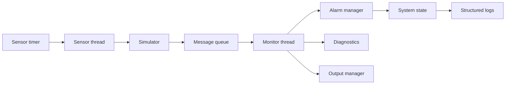

# STM32 Smart Monitoring System

## Project overview

This project implements a modular Zephyr-based monitoring application for a simulated environment with temperature, humidity, and light sensors. The design keeps a real-time control loop, message-based communication, and deterministic simulation scenarios while remaining compatible with a future port to a physical STM32 target.

## Project objectives

- Preserve a functional Zephyr application on `native_sim`.
- Separate sensor acquisition, simulation, alarm evaluation, monitoring and diagnostics.
- Keep deterministic and reproducible scenarios for testing.
- Document thresholds, hysteresis, and system state transitions.
- Provide a maintainable architecture ready for a GitHub publication.

## Current implementation status

The current codebase is a working baseline running on Zephyr native simulation. It includes coordinated threads, message queue handling, periodic acquisition, sensor simulation, and alarm logic. The updated version refactors the core logic around explicit sensor validation and hysteresis-based alarm handling without changing the core behavior of the existing application.

## Features

- Periodic sensor acquisition using `k_timer` and `k_sem`.
- Deterministic sensor simulator with multiple scenarios.
- Warning/critical alarm management with hysteresis.
- Invalid measurement and sensor fault handling.
- Message loss tracking and monitoring metrics.
- Structured logs for diagnostics and system state changes.
- Host-side automated tests for core logic.

## Software architecture

The application is organized around a small set of modules:

- `main.c`: lifecycle, threads and timer.
- `sensors/sensor_manager.c`: shared sensor structures and validation utilities.
- `simulator/sensor_simulator.c`: deterministic scenario generation.
- `alarms/alarm_manager.c`: threshold/hysteresis logic and global system state.
- `monitoring/monitor_manager.c`: counters for generated, received, dropped and timed-out data.
- `diagnostics/diagnostics.c`: signal defects and event tracking.
- `output/output_manager.c`: readable, structured reporting.

## Architecture diagram



## Threading and message flow

- `sensor_thread` waits on a semaphore released by a periodic timer.
- Each cycle generates a deterministic measurement set.
- Valid messages are published into `sensor_msgq` with a fixed queue capacity.
- Invalid messages are recorded by diagnostics and discarded before the queue;
  they do not update the application alarm state.
- `monitor_thread` consumes the queue and evaluates validity and alarm state.
- Queue statistics detect dropped messages and timeouts.

## Alarm thresholds and hysteresis

Default thresholds are preserved from the original project:

- Temperature: warning 30.0 C, critical 35.0 C, clear from critical 34.0 C, clear to normal 29.0 C.
- Humidity: warning 70 %, critical 85 %, clear from critical 80 %, clear to normal 65 %.
- Light: warning 800 lux, critical 1000 lux, clear from critical 950 lux, clear to normal 750 lux.

Hysteresis is applied in both directions and invalid sensor data does not trigger environmental alarm logic.

## Simulator scenarios

The simulator offers deterministic scenarios:

- NORMAL
- OVERHEAT
- HIGH_HUMIDITY
- HIGH_LIGHT
- SIMULTANEOUS_ALARMS
- FAILURE

These scenarios are reproducible because they rely on fixed formulas and cycle-based progression, not random behavior.

## Build requirements

- Ubuntu 24.04
- Zephyr v4.5.0-rc1 or compatible version
- Python environment located at `~/zephyrproject/.venv`
- Zephyr SDK at `~/zephyr-sdk-1.0.1`
- `ninja`, `cmake`, `git`, `gcc`

## Installation instructions

```bash
python3 -m venv "$HOME/zephyrproject/.venv"
source "$HOME/zephyrproject/.venv/bin/activate"
python -m pip install --upgrade pip west
west init -m https://github.com/zephyrproject-rtos/zephyr \
  --mr v4.5.0-rc1 "$HOME/zephyrproject"
cd "$HOME/zephyrproject"
west update
west zephyr-export
python -m pip install -r zephyr/scripts/requirements.txt
```

Install the Zephyr SDK 1.0.1 GNU bundle for your host and set
`ZEPHYR_SDK_INSTALL_DIR` to its installation directory.

## Build instructions

```bash
source "$HOME/zephyrproject/.venv/bin/activate"
cd "$HOME/zephyrproject"
PROJECT_DIR=/path/to/stm32-smart-monitoring
west build -p always -b native_sim "$PROJECT_DIR" -d "$PROJECT_DIR/build"
```

## Run instructions

```bash
cd /path/to/stm32-smart-monitoring
./build/zephyr/zephyr.exe
```

To stop the native simulation after a short smoke test:

```bash
timeout 15s ./build/zephyr/zephyr.exe
```

## Automated testing instructions

Host-side unit tests are available in `tests/unit` and can be run as follows:

```bash
gcc -std=c11 -Wall -Wextra -Werror -I src \
  tests/unit/test_alarm_manager.c \
  src/sensors/sensor_manager.c \
  src/alarms/alarm_manager.c \
  src/simulator/sensor_simulator.c \
  -o /tmp/test_alarm_manager
/tmp/test_alarm_manager

gcc -std=c11 -Wall -Wextra -Werror -I src \
  tests/unit/test_scenarios.c \
  src/sensors/sensor_manager.c \
  src/alarms/alarm_manager.c \
  src/simulator/sensor_simulator.c \
  -o /tmp/test_scenarios
/tmp/test_scenarios

python3 tests/unit/test_log_to_csv.py
```

## Visualization instructions

The log converter and plotting helper require the Python dependency in
`requirements.txt`. Activate the project's Python environment and install it:

```bash
source ~/zephyrproject/.venv/bin/activate
python3 -m pip install -r requirements.txt
```

From the project directory, run the native simulation, convert its logs to CSV,
and generate the plot:

```bash
timeout 30s ./build/zephyr/zephyr.exe > run.log
python3 scripts/log_to_csv.py --input run.log --output measurements.csv
python3 scripts/visualize_monitoring.py --input measurements.csv
```

The converter assigns `INVALID` to cycles without a corresponding system-state
log line. The plot includes temperature, humidity, light, and a system-state
count chart. To convert a live stream instead, use:

```bash
timeout 30s ./build/zephyr/zephyr.exe | \
  python3 scripts/log_to_csv.py --input - --output measurements.csv
```

The visualization script validates the CSV columns and writes
`monitoring_plot.png` by default.

## Example output

```text
cycle=1 timestamp_ms=2000 temp=25.3C humidity=56% light=497 lux valid=(1,1,1)
system_state=NORMAL generated=1 received=1 lost=0 invalid=0 timeouts=0
```

## Known limitations

- The application is validated on `native_sim` only.
- No physical STM32 sensor board or external hardware has been used.
- `scripts/log_to_csv.py` converts native simulation logs; other log formats are not supported.
- The monitor thread discards invalid measurements after recording diagnostics, so
  the displayed alarm state remains the last state computed from valid data.
- CI is prepared as a build smoke test but does not replace physical hardware validation.

## Future improvements

- Add Twister/ZTest integration for formal Zephyr-based unit coverage.
- Introduce explicit boot-time scenario selection via Kconfig or application config.
- Export CSV directly from the monitoring application.
- Port the same architecture to a real STM32 board with concrete drivers.

## Repository structure

```text
.
├── CMakeLists.txt
├── prj.conf
├── README.md
├── src/
│   ├── main.c
│   ├── sensors/
│   ├── alarms/
│   ├── simulator/
│   ├── monitoring/
│   ├── diagnostics/
│   └── output/
├── tests/
│   └── unit/
├── docs/
├── scripts/
├── .github/
└── .gitignore
```

## License

This project is licensed under the MIT License. See [LICENSE](LICENSE).
